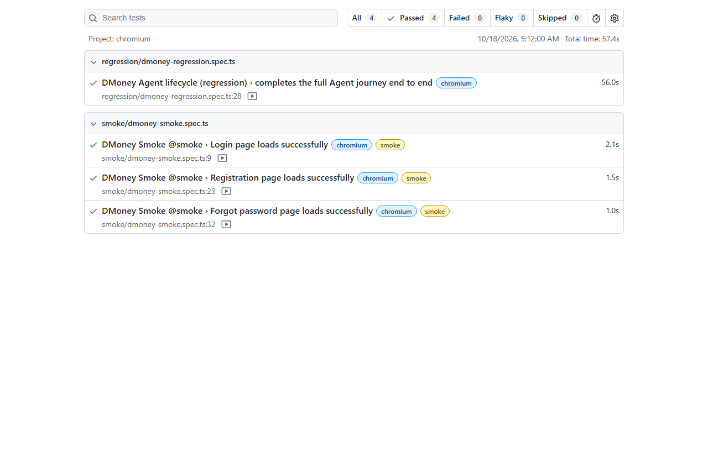
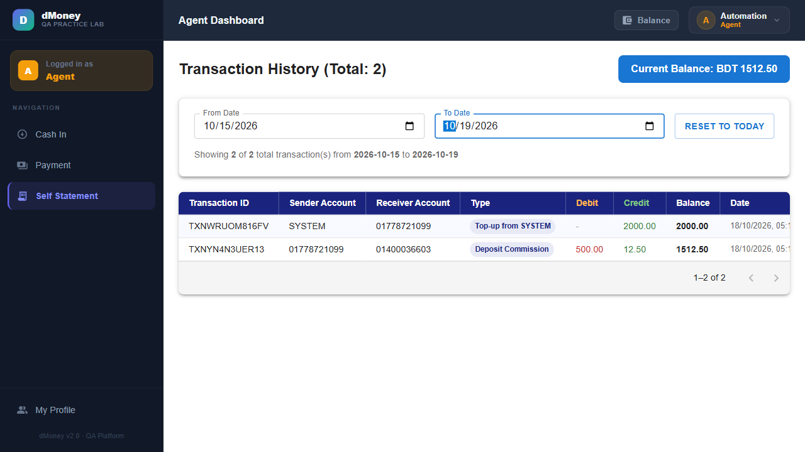
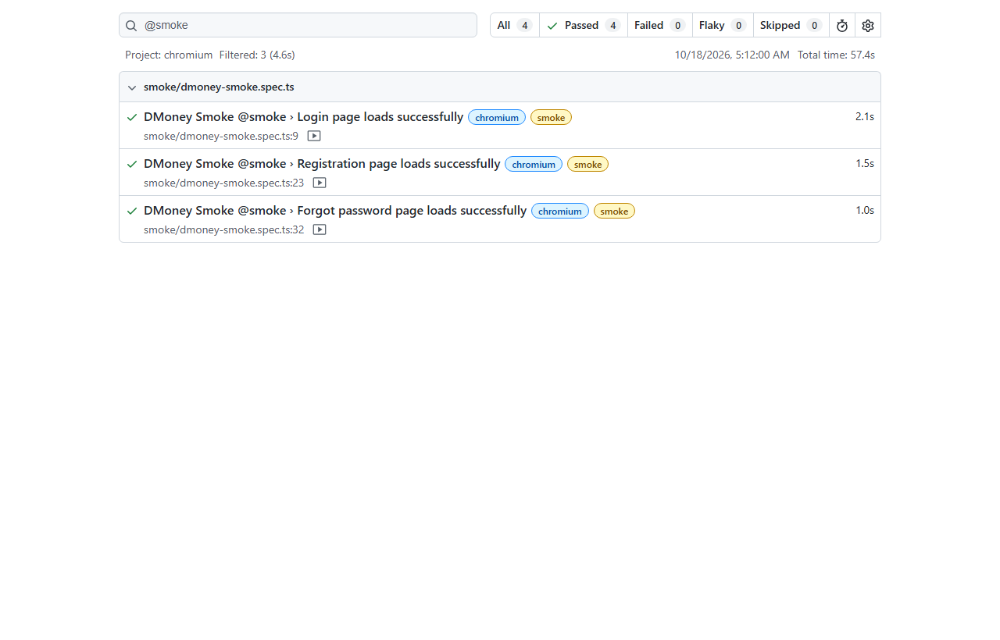

# DMoney Portal — Playwright E2E Automation


Automated end-to-end coverage of the full Agent lifecycle on the
[DMoney practice portal](https://dmoneyportal.roadtocareer.net), built with
Playwright, TypeScript, and the Page Object Model. One regression test walks
the complete journey — register an Agent, approve it as Admin, top it up from
the System account, run Agent → Customer deposits, reset the password, and
export the Self Statement — while a smoke suite covers the public page loads.

## Contents

- [Scenario](#scenario)
- [Validation coverage](#validation-coverage)
- [Tech stack](#tech-stack)
- [Project layout](#project-layout)
- [Setup](#setup)
- [Running the suites](#running-the-suites)
- [Statement CSV](#statement-csv)
- [Evidence](#evidence)
- [Notes](#notes)

## Scenario

1. Open the portal and register a new user with the **Agent** role.
2. Log in as **Admin** (`admin@dmoney.com`), find the new Agent, and activate it.
3. Log in as **System** (`system@dmoney.com`) and deposit **2000 Tk** to the Agent.
4. Log in as the **Agent** (OTP via email) and confirm the balance is 2000 Tk.
5. Deposit **500 Tk** from the Agent to an existing Customer and verify the result.
6. Reset the Agent password; confirm the old password fails and the new one works.
7. Open **Self Statement**, extract every row, and save it to
   `reports/self_statement_<today>.csv`.

## Validation coverage

| # | Assertion |
|---|-----------|
| 1 | Agent registration succeeds (pending-approval message shown) |
| 2 | New Agent is initially **PENDING** (inactive) |
| 3 | Admin login succeeds |
| 4 | New Agent appears in the Admin user list |
| 5 | Admin activates the Agent |
| 6 | Agent stays **ACTIVE** after a page reload |
| 7 | System login succeeds |
| 8 | System deposits 2000 Tk to the Agent |
| 9 | System deposit creates the correct transaction record |
| 10 | Agent can log in after activation (OTP) |
| 11 | Agent balance is exactly 2000 Tk |
| 12 | Agent deposits 500 Tk to an existing Customer |
| 13 | Agent balance updates correctly (1512.50 Tk, incl. commission) |
| 14 | The Customer deposit appears in the Agent's Self Statement |
| 15 | Agent logout works |
| 16 | Agent password reset works |
| 17 | Login with the old password fails after reset |
| 18 | Login with the new password succeeds |
| 19 | Self Statement contains the expected transactions |
| 20 | Self Statement data is saved to the required CSV file |

The **smoke** suite separately verifies that the Login, Registration, and
Forgot-Password pages load.

## Tech stack

- Playwright Test + TypeScript (Node.js 20+)
- Chromium (headed) with video + screenshots captured per run
- Page Object Model (`pages/`)
- Gmail REST API for login OTPs and password-reset links (`utils/GmailClient.ts`)

## Project layout

```text
.
├── data/
│   └── testData.ts              # credentials + per-run unique Agent data
├── docs/
│   └── evidence/                # screenshots + recorded video for this README
├── pages/
│   ├── AdminPage.ts
│   ├── AgentPage.ts
│   ├── LoginPage.ts
│   ├── PasswordResetPage.ts
│   ├── SignupPage.ts
│   └── SystemPage.ts
├── reports/
│   └── self_statement_<date>.csv  # generated statement export
├── tests/
│   ├── regression/dmoney-regression.spec.ts
│   └── smoke/dmoney-smoke.spec.ts
├── utils/
│   └── GmailClient.ts
├── .env.example
├── playwright.config.ts
└── package.json
```

## Setup

1. Install **Node.js 20+**.
2. Install dependencies and the Chromium browser:

   ```sh
   npm install
   npx playwright install chromium
   ```

3. Create a `.env` file (copy from `.env.example`) with a Gmail OAuth 2.0
   access token for the mailbox that receives the Agent's emails:

   ```env
   GMAIL_ACCESS_TOKEN=ya29.your_google_oauth_access_token
   ```

   Get one quickly from the
   [OAuth 2.0 Playground](https://developers.google.com/oauthplayground):
   authorize the `https://www.googleapis.com/auth/gmail.readonly` scope,
   exchange the code, and copy the access token. Tokens expire in ~1 hour, so
   refresh it right before a run. `.env` is git-ignored — never commit it.

## Running the suites

```sh
npm test               # everything (headed Chromium)
npm run test:regression  # full Agent-lifecycle journey
npm run test:smoke       # page-load smoke checks
npm run report           # open the last HTML report
```

All runs are headed and record video + screenshots. The raw HTML report and
artifacts land in `playwright-report/` and `test-results/`, both git-ignored.

## Statement CSV

The regression test pages through the entire Self Statement and writes a dated
export:

```text
reports/self_statement_YYYY-MM-DD.csv
```

Columns: `Transaction ID, Sender Account, Receiver Account, Type, Debit,
Credit, Balance, Date` — including the 2000 Tk System top-up and the 500 Tk
Customer deposit.

Latest generated export:
[self_statement_2026-10-18.csv](reports/self_statement_2026-10-18.csv)

## Evidence

> Captured from a headed run against the live portal.

### Regression Test Result

Full Playwright report — the regression journey and all smoke checks passing
(**4 passed, 0 failed**):



The Agent Self Statement at the end of the run, showing the 2000 Tk System
top-up and the 500 Tk Customer deposit (balance 1512.50 Tk):



- Headed walkthrough video: [regression-video.webm](docs/evidence/regression-video.webm)

### SmokeTest Result

Smoke suite filtered in the report (**3 passed** — Login, Registration, and
Forgot Password page loads):



## Notes

- The regression test performs **real** actions on the live portal: it creates
  an Agent, changes account status and password, and moves money. Run it only
  when those live actions are intended.
- Agent login and password reset depend on Gmail access to the configured
  mailbox; a valid, unexpired token is required.
- Existing Customer accounts are discovered from the Admin user list at run
  time, and the deposit retries across candidates until one is accepted.
- `.env`, `test-results/`, and `playwright-report/` are git-ignored; only the
  curated evidence under `docs/evidence/` is kept for this README.
